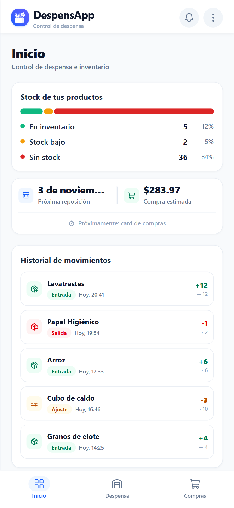
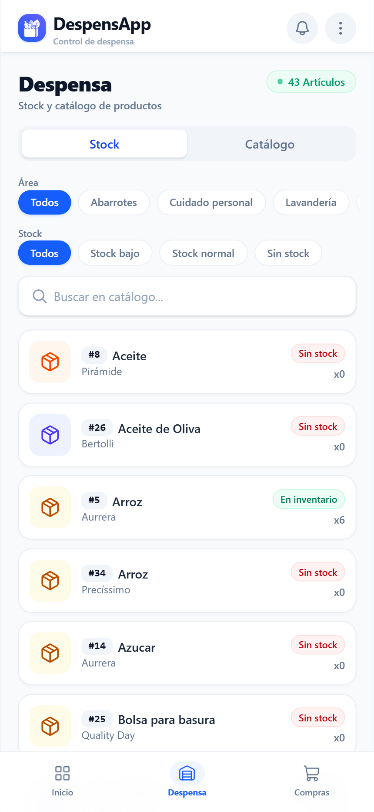
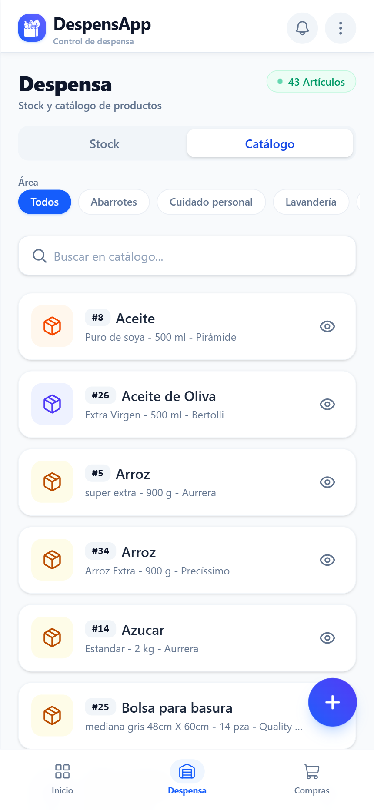
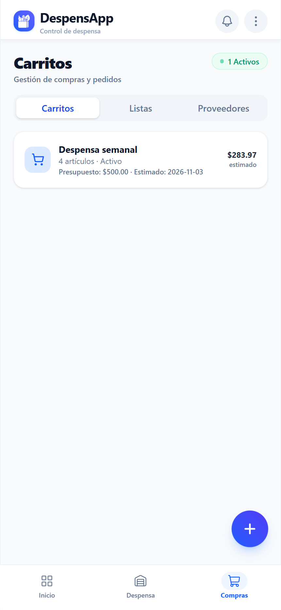
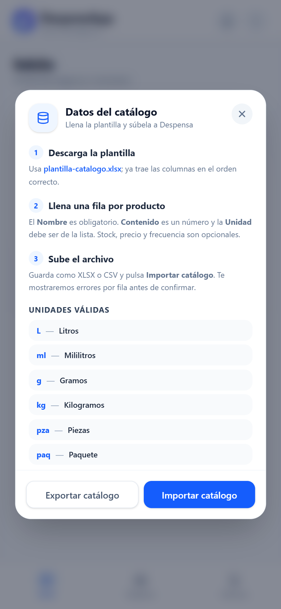

# DespensApp

**Controla tu despensa desde el celular, sin cuentas, sin nube y sin internet.**

DespensApp es una PWA local-first para administrar la despensa de tu casa: catálogo de productos, inventario con niveles mínimos, compras programadas, proveedores, carritos y listas. Todos los datos viven en tu dispositivo (IndexedDB) — funciona 100% offline y es instalable como app nativa.

<p align="center">
  
  
  
</p>
<p align="center">
  
  
</p>

## ¿Qué puede hacer?

- **Inicio con indicadores**: barra de estado del stock (en inventario / stock bajo / sin stock), próxima reposición y compra estimada de tu carrito activo, e historial de movimientos con una tarjeta por entrada, salida o ajuste.
- **Despensa**: inventario con badges de estado (En inventario, Stock bajo, Sin stock), filtros por área y por estado de stock, búsqueda instantánea y cantidades a la vista.
- **Catálogo**: productos con contenido y unidad de medida ("900 g", "1 L"), marcas, familias, áreas y propiedades personalizadas por producto.
- **Compras**: carritos con presupuesto y fecha estimada, listas de compras y proveedores con precio y frecuencia de compra por producto.
- **Movimientos**: registra entradas, salidas y ajustes de inventario; el historial muestra el delta y el stock resultante de cada movimiento.
- **Importar / exportar catálogo**: descarga una plantilla **.xlsx** (o usa CSV), llénala en Excel o Google Sheets desde el celular y súbela — la importación valida fila por fila y te muestra los errores antes de confirmar. También puedes exportar todo tu catálogo a .xlsx para respaldarlo o editarlo.
- **Respaldo completo**: exporta toda la base de datos a un archivo JSON y restáurala en otro dispositivo (por ejemplo, de tu PC a tu celular).
- **Notificaciones de stock**: aviso cuando un producto cruza su nivel mínimo.
- **PWA offline-first**: instálala desde Chrome ("Instalar aplicación") y úsala sin conexión; los datos persisten en el dispositivo.

## Stack

| Capa | Tecnología |
|---|---|
| UI | React 19 + TypeScript + Tailwind CSS 4 |
| Build | Vite |
| Datos | Dexie (IndexedDB) — 100% local, sin servidor |
| Hojas de cálculo | SheetJS (xlsx) — importación y exportación |
| PWA | vite-plugin-pwa (service worker, instalable, offline) |
| Íconos | Lucide + set propio de categorías de despensa |
| Tests | Vitest + Testing Library (240+ pruebas) |

## Desarrollo

```bash
pnpm install
pnpm dev        # http://localhost:5273
```

```bash
pnpm test       # suite completa (Vitest)
pnpm build      # build de producción
pnpm preview --host --port 4173   # HTTPS para instalar la PWA desde el celular
```

### Instalar en el celular (Wi-Fi local)

1. `pnpm build && pnpm preview --host --port 4173`
2. Desde el celular (misma red Wi-Fi): abre `https://<IP-de-tu-PC>:4173` y acepta el certificado autogenerado.
3. Menú de Chrome → **Instalar aplicación**.

La base de datos de cada dispositivo es independiente: usa **Respaldo de datos** (menú ⋯ → Respaldo de datos) para exportar un `.json` desde el origen y restaurarlo en el destino.

## Estructura

```
src/
  app/          # shell (header, tabs, FAB), menú de datos, respaldo
  features/
    products/   # catálogo, formulario, detalle, importación/exportación xlsx
    inventory/  # stock, movimientos, niveles, bitácora
    purchase/   # carritos, listas, proveedores
    reports/    # dashboard de Inicio
  db/           # esquema Dexie + migraciones + tipos
docs/           # guía de diseño (Stitch), diagramas drawio, capturas
designs/        # proyecto de diseño en pen.dev (.pen)
```
